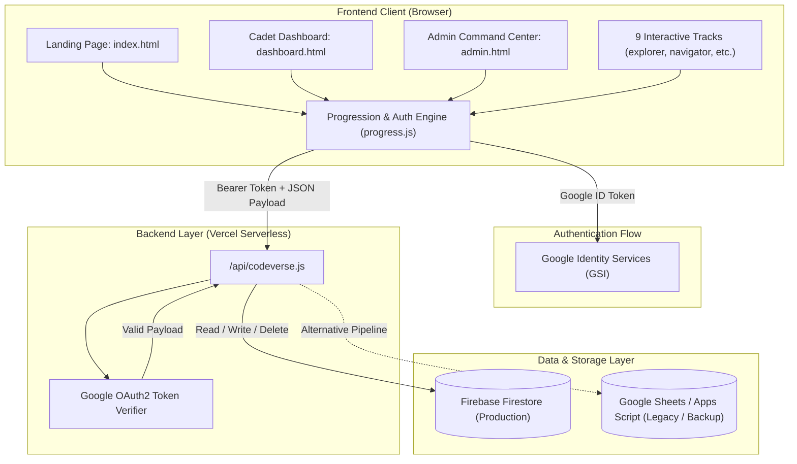

# 🚀 CodeVerse Academy — Application Architecture & Review Document

> **Platform:** CodeVerse Academy (Interactive Space-Themed STEM & Coding Learning Environment)  
> **Repository:** `ChaoprayaSoft/codeverse-academy`  
> **Target Audience:** Kids & Teens (Ages 5–15+) and Advanced Learners  
> **Tech Stack:** Vanilla HTML5, Vanilla CSS3 (Custom Glassmorphism & Cyberpunk Design System), Vanilla ES6+ JavaScript, Node.js (Vercel Serverless Functions), Firebase Firestore, Google OAuth 2.0.

---

## 📑 Table of Contents
1. [Executive Summary](#-executive-summary)
2. [High-Level Architecture](#-high-level-architecture)
3. [Gamification & Progression Engine](#-gamification--progression-engine)
4. [Curriculum & Interactive Tracks](#-curriculum--interactive-tracks)
5. [Authentication & Role-Based Access Control (RBAC)](#-authentication--role-based-access-control-rbac)
6. [API & Backend Infrastructure](#-api--backend-infrastructure)
7. [UI/UX & Design System](#-uiux--design-system)
8. [Complete File Directory & Module Breakdown](#-complete-file-directory--module-breakdown)
9. [Deployment & Environment Setup](#-deployment--environment-setup)
10. [Review, Strengths & Enhancement Roadmap](#-review-strengths--enhancement-roadmap)

---

## 🌟 Executive Summary

**CodeVerse Academy** is a comprehensive, gamified web-based educational platform engineered to take students from visual block-based programming (Ages 5–8) to advanced computer science, AI/ML, computer vision, robotics, and system architecture (Ages 15+).

The application is themed around space exploration, where learners act as **Cadets**, **Navigators**, and **Commanders**, earning Experience Points (**XP**), unlocking **Badges**, and ascending through military-style rank tiers by solving hands-on interactive code missions.

```
+-------------------------------------------------------------------------------+
|                             CODEVERSE ACADEMY                                 |
+-------------------------------------------------------------------------------+
|  Ages 5-8: Explorer   -> Visual Block Logic, Loops, Directional Pathfinding   |
|  Ages 9-12: Navigator -> Pythonic Control Scripting, Spaceship Physics Engine  |
|  Ages 13-15: Commander-> Multi-Tab IDE (HTML/CSS, Flask API, OpenCV, Three.js) |
|  Ages 15+: Architect  -> System Engineering, Python Architecture, Ops         |
|  Specialized Tracks   -> AI/ML, Computer Vision, Prompt Eng, Robotics, Data   |
+-------------------------------------------------------------------------------+
```

---

## 🏗️ High-Level Architecture

The platform is designed with a lightweight, zero-build frontend coupled with serverless API micro-services and cloud persistence:



---

## 🎮 Gamification & Progression Engine

Managed by [`progress.js`](file:///i:/WebApp/CodeVerse/progress.js) and enforced on the backend by [`api/codeverse.js`](file:///i:/WebApp/CodeVerse/api/codeverse.js):

### 1. Reward Matrix (`COURSE_REWARDS`)
| Track Key | Track Name | Level Reward | Course Completion Reward | Total Levels |
|:---|:---|:---:|:---:|:---:|
| `explorer` | Explorer Academy | +20 XP | +250 XP | 5 |
| `navigator` | Navigator Terminal | +25 XP | +500 XP | 6 |
| `commander` | Commander IDE | +30 XP | +400 XP | 5 |
| `architect` | Architect Systems | +40 XP | +500 XP | 12 |
| `data_analytic` | Data Analytics | +20 XP | +300 XP | 10 |
| `ai_ml` | AI & Machine Learning | +15 XP | +500 XP | 20 |
| `vision` | Computer Vision | +50 XP | +250 XP | 15 |
| `prompt_eng` | Prompt Engineering | +30 XP | +500 XP | 10 |
| `robotics` | Robotics Fundamentals | +50 XP | +500 XP | 20 |

### 2. Rank Tiers & Progression Formula
Cadets level up dynamically based on accumulated XP:
- **Novice:** 0 – 1,999 XP
- **Explorer:** 2,000 – 4,999 XP
- **Navigator:** 5,000 – 9,999 XP
- **Commander:** 10,000 – 19,999 XP
- **Architect:** 20,000 – 34,999 XP
- **Space Legend:** 35,000+ XP

### 3. State Management & Storage
- **Local Persistence:** Cached in `localStorage` under `codeverse_progress`, `codeverse_user`, and `codeverse_last_activity`.
- **Security Inactivity Window:** 1-hour session timeout (`SESSION_TIMEOUT_MS = 3,600,000 ms`).
- **Cloud Sync:** Seamless automatic background and manual synchronization with Firebase Firestore.
- **Event-Driven UI:** Dispatches custom window events (`userStateChanged`, `progressUpdated`) to instantly reactively update UI elements across tabs without reloading.

---

## 📚 Curriculum & Interactive Tracks

### 1. 🚀 Explorer Academy (`explorer.html`, `explorer.js`, `explorer.css`)
- **Target:** Ages 5–8 (Early Learners)
- **Mechanics:** 5x5 Space grid puzzle. Players assemble step-by-step sequential commands (Move Up, Down, Left, Right, Space Jump, Repeat 2x).
- **Characters:** Astronaut (👨‍🚀), Alien (👾), Robot (🤖), Rubber Duck (🐥).
- **Core Concepts:** Sequential logic, obstacle avoidance, loop multipliers, and algorithm debugging.

### 2. 🛰️ Navigator Terminal (`navigator.html`, `navigator.js`, `navigator.css`)
- **Target:** Ages 9–12 (Intermediate)
- **Mechanics:** Sci-Fi spaceship dashboard with live telemetry (Engine Power, Life Support, Energy, Velocity, Shields, Fuel, Warp Status).
- **Core Concepts:** Python function execution (`ship.repair_engine()`, `ship.thrust(seconds)`, `ship.activate_hyperdrive()`), state machines, and mathematical calculations.

### 3. 🛸 Commander IDE (`commander.html`, `commander.js`, `commander.css`)
- **Target:** Ages 13–15 (Teens)
- **Mechanics:** Full multi-tab IDE featuring syntax-highlighted code editors for HTML, CSS, Flask API backend routes, OpenCV Vision algorithms, and 3D Game scenes (Three.js).
- **Core Concepts:** Full-stack web development, REST API design, edge filters, and real-time canvas rendering.

### 4. 🌌 Architect Systems (`architect.html`, `architect.js`, `architect.css`)
- **Target:** Ages 15+ (Advanced)
- **Mechanics:** 12-stage progressive engineering challenges with interactive code evaluation and live objective completion checkers.
- **Core Concepts:** Core Python syntax, functional programming, sensor data pipelines, class design, microservice APIs, and machine learning operations (MLOps).

### 5. 📊 Data Analytics (`data_analytic.html`, `data_analytic.js`, `data_analytic.css`)
- **Target:** Ages 15+
- **Mechanics:** Panda-themed interactive terminal and dataset explorer.
- **Core Concepts:** Array manipulation, dataset filtering, data frames, statistical aggregations, and data visualization.

### 6. 🧠 AI & Machine Learning (`ai_ml.html`, `ai_ml.js`, `ai_ml.css`)
- **Target:** Ages 15+ (20 Comprehensive Levels)
- **Mechanics:** Neural network playground, model training simulators, and code sandboxes.
- **Core Concepts:** Perceptrons, activation functions, gradient descent, NLP tokenization, computer vision models, and hyperparameter tuning.

### 7. 🖥️ Computer Vision (`vision.html`, `vision.js`, `vision.css`)
- **Target:** Ages 15+ (15 Levels)
- **Mechanics:** Real-time visual canvas filters and image processing pipeline.
- **Core Concepts:** Image matrix representation, Gaussian blur, Canny edge detection, Sobel kernels, HSV color space segmentation, and contour recognition.

### 8. 💬 Prompt Engineering (`prompt_eng.html`, `prompt_eng.js`, `prompt_eng.css`)
- **Target:** Ages 15+ (10 Levels)
- **Mechanics:** LLM simulator with scoring metric on prompt clarity, precision, and adherence.
- **Core Concepts:** System prompt personas, zero-shot/few-shot prompting, Chain of Thought (CoT), output constraint formatting (JSON/Markdown), and safety guardrails against prompt injection.

### 9. 🤖 Fundamentals of Robotics (`robotics.html`, `robotics.js`)
- **Target:** Ages 15+ (20 Levels)
- **Mechanics:** Virtual robot simulator with hardware pinouts, motor telemetry, and sensor feedback.
- **Core Concepts:** Sensor signal decoding (Ultrasonic, LiDAR, Gyro), PID motor controllers, actuator kinematics, and autonomous navigation state logic.

---

## 🔐 Authentication & Role-Based Access Control (RBAC)

### Role Hierarchy
```
           +-----------------------+
           |        Admin          |  -> Access to Command Center, User Deletion, Blocklist
           +-----------+-----------+
                       |
           +-----------+-----------+
           |        Teacher        |  -> Access to Cadet Analytics & Cohort Monitoring
           +-----------+-----------+
                       |
           +-----------+-----------+
           |        Student        |  -> Standard Learning & Dashboard Experience
           +-----------+-----------+
                       |
           +-----------+-----------+
                       |         Guest         |  -> Local-only Progress (Non-synced)
           +-----------------------+
```

### Security Flow
1. User signs in via Google Identity Services (`gsi/client`).
2. Google returns an `id_token`.
3. Client stores token in `localStorage.getItem('codeverse_google_token')`.
4. Client requests to `/api/codeverse` send `Authorization: Bearer <id_token>`.
5. Server verifies token using Google OAuth2 client (`google-auth-library`).
6. Verified email is queried in Firestore `users` collection.
7. Blocked emails are checked against the `blocked_emails` collection to prevent banned users from accessing the API.

---

## ⚡ API & Backend Infrastructure

### `/api/codeverse.js` Serverless Function

The main serverless handler routes multiple actions based on verified user claims:

| Action | HTTP Method | Required Role | Payload Details | Description |
|:---|:---:|:---:|:---|:---|
| `load` | `POST`/`GET` | Any Auth | `{ email }` | Loads user profile, avatar, color accent, role, and progress data. |
| `sync` | `POST` | Any Auth | `{ progress, name, avatar, color, role }` | Saves latest client progress and updates status to `Active`. |
| `login` | `POST` | Any Auth | `{ ...profile }` | Logs user in, sets status to `Online`. |
| `logout` | `POST` | Any Auth | `{}` | Sets user status to `Offline`. |
| `advanceLevel` | `POST` | Any Auth | `{ courseKey, newLevel }` | Validates level progression and awards incremental XP. |
| `completeCourse` | `POST` | Any Auth | `{ courseKey }` | Marks track complete, awards course-level XP bonus, and awards Wings badge. |
| `getUsers` | `POST` | **Admin** | `{}` | Returns all users, roles, XP totals, and statuses for the admin table. |
| `removeUser` | `POST` | **Admin** | `{ targetEmail }` | Deletes user from `users` collection and adds to `blocked_emails`. |

---

## 🎨 UI/UX & Design System

The application utilizes a custom CSS design system optimized for dark mode space aesthetics:

- **Color Tokens:**
  - Primary Neon Purple: `#6366f1` / `#818cf8`
  - Deep Space Background: `#0b0f19` / `#0f172a`
  - Neon Accent Cyan: `#06b6d4` / `#22d3ee`
  - Warning/XP Amber: `#f59e0b`
  - Success Emerald: `#10b981`
  - Alert Rose: `#ef4444`
  - Glass Card Background: `rgba(30, 41, 59, 0.7)` with `backdrop-filter: blur(16px)`
- **Typography:** Google Fonts (`Inter`, `Nunito`, `Orbitron`, `Fira Code` for code blocks).
- **Visual Effects:** Dynamic starfield backgrounds, glow-on-hover buttons, pulse animations for mission unlocks, and scroll reveal animations (`app.js`).

---

## 📁 Complete File Directory & Module Breakdown

```
CodeVerse/
├── 🌐 Pages & Views
│   ├── index.html                  # Main Landing Page & Track Explorer
│   ├── dashboard.html              # Cadet Profile, Badge Showcase & Mission Launcher
│   ├── admin.html                  # Command Center for Admin User & Role Management
│   ├── explorer.html               # Explorer Academy (Block Logic & Grid Game)
│   ├── navigator.html              # Navigator Terminal (Spaceship Command Center)
│   ├── commander.html              # Commander IDE (Fullstack / Vision / 3D Labs)
│   ├── architect.html              # Architect Systems (System Design & Python Architecture)
│   ├── data_analytic.html          # Data Analytics Track
│   ├── ai_ml.html                  # AI & Machine Learning Track
│   ├── vision.html                 # Computer Vision Lab (OpenCV in JS)
│   ├── prompt_eng.html             # Prompt Engineering Track
│   └── robotics.html               # Robotics & Autonomous Systems Track
│
├── 🎨 Styling (Vanilla CSS3)
│   ├── style.css                   # Landing page styles & global design tokens
│   ├── dashboard.css               # Dashboard layout, XP meters, and badge grids
│   ├── admin.css                   # Admin Command Center cards, tables, and modal styles
│   ├── explorer.css                # Grid puzzle layout and block sequence builder
│   ├── navigator.css               # Spaceship telemetry HUD and terminal styling
│   ├── commander.css               # Multi-tab IDE layout and frame preview
│   ├── architect.css               # Code editor styling and objective lists
│   ├── data_analytic.css           # Data table and visualization styles
│   ├── ai_ml.css                   # Neural network visualizer & ML interactive cards
│   ├── vision.css                  # Canvas viewport & filter controls
│   └── prompt_eng.css              # Chat simulation & prompt scoring UI
│
├── ⚙️ Scripts & Logic (Client & Modules)
│   ├── app.js                      # Landing page scroll-reveal & interactive sandbox
│   ├── progress.js                 # Global client-side progression, auth state & sync engine
│   ├── explorer.js                 # Grid movement execution & level validation
│   ├── navigator.js                # Physics engine, telemetry updates & command parser
│   ├── commander.js                # Multi-language code validation & live preview
│   ├── architect.js                # Regex-based solution checker & code evaluation
│   ├── data_analytic.js            # Dataset simulation & query validator
│   ├── ai_ml.js                    # ML model training simulator & step validation
│   ├── vision.js                   # Canvas pixel processing & OpenCV filter mock
│   ├── prompt_eng.js               # Prompt analysis engine & criteria grader
│   └── robotics.js                 # Robot state machine, sensor reader & logic checker
│
├── ☁️ Backend & Cloud API
│   ├── api/
│   │   └── codeverse.js            # Vercel Serverless API (OAuth2 + Firebase Firestore)
│   ├── apps_script.gs              # Google Apps Script (Legacy Google Sheets Backend)
│   ├── migrate_codeverse_to_firebase.js # Database migration script
│   └── fix_api.js                  # Deployment helper script
│
├── 📦 Assets & Configuration
│   ├── assets/
│   │   ├── mascot.png              # CodeVerse Astronaut Mascot
│   │   └── (Icons, illustrations, and media assets)
│   ├── package.json                # Project dependencies (firebase, google-auth-library)
│   └── .gitignore                  # Git ignore rules
```

---

## 🚀 Deployment & Environment Setup

### 1. Prerequisites
- **Node.js:** v18+ or v20+
- **Firebase Project:** Firestore Database initialized in production mode.
- **Google Cloud Console:** OAuth 2.0 Client ID configured with authorized JavaScript origins and redirect URIs.

### 2. Local Development
To run locally:
```bash
# Clone the repository
git clone https://github.com/ChaoprayaSoft/codeverse-academy.git
cd codeverse-academy

# Install dependencies
npm install

# Start a local static HTTP server (e.g., Live Server or npx serve)
npx serve .
```

### 3. Vercel Deployment
Deploying to Vercel requires no custom build step:
1. Connect the GitHub repository `ChaoprayaSoft/codeverse-academy` to Vercel.
2. Vercel automatically detects `/api/codeverse.js` as a Serverless Function.
3. Verify that the Google Client ID in [`api/codeverse.js`](file:///i:/WebApp/CodeVerse/api/codeverse.js) matches the authorized domain in Google Cloud Console.

---

## 🔍 Review, Strengths & Enhancement Roadmap

### ✅ Core Strengths
1. **Zero-Dependency Frontend:** Instant load times with zero bundle overhead; pure vanilla HTML/CSS/JS means zero compile lag.
2. **Cohesive Space Theme:** High immersion through consistent UI tokens, mascot presence, interactive audio cues, and cadet ranks.
3. **Comprehensive Age Ramp:** Smooth transition from visual block sequencing (5-year-olds) to real-world OpenCV, REST APIs, and Prompt Engineering (15+).
4. **Secure Token-Based API:** Direct Google ID token verification eliminates the risk of client-side identity spoofing.
5. **Resilient Local-First Architecture:** Students can practice offline or as guests; cloud syncing is activated upon sign-in.

### 💡 Suggested Enhancements
- [ ] **Real Code Sandbox Execution:** Integrate Pyodide / WebAssembly for client-side Python execution in the Navigator and Architect tracks instead of regex-only checks.
- [ ] **Multiplayer Leaderboards & Classrooms:** Allow Teachers to create Cohorts/Classes and assign specific tracks with real-time assignment tracking.
- [ ] **PWA & Offline Mode:** Add a Service Worker (`sw.js`) and Web App Manifest for tablet installation in classrooms without steady Wi-Fi.
- [ ] **Multilingual Support (i18n):** Add language switching (e.g., English, Thai) for wider international school adoption.
